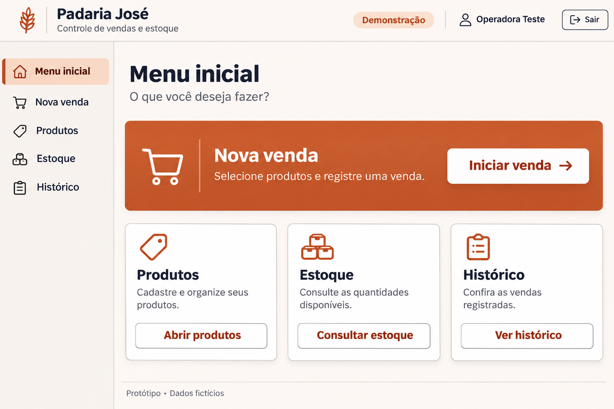
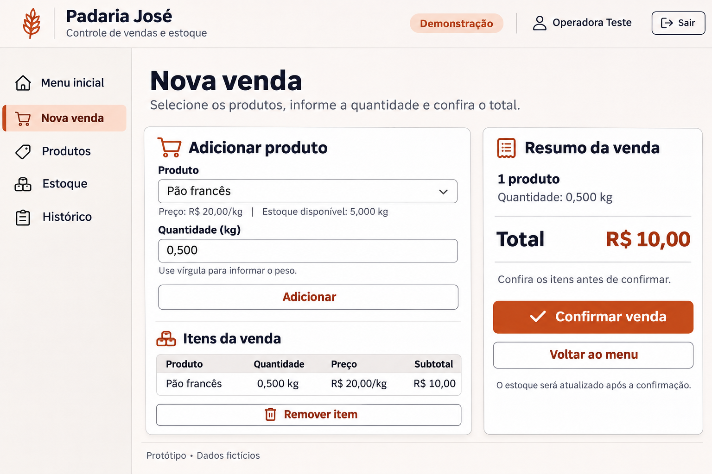
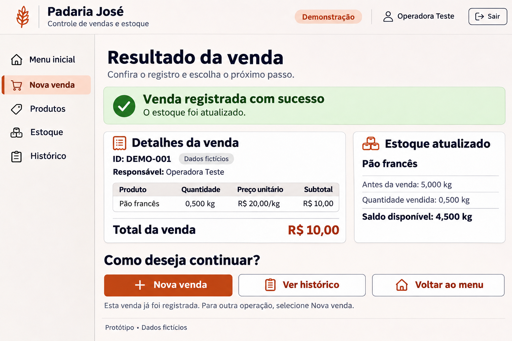

# Padaria José — MVP de vendas e estoque

Planejamento acadêmico e protótipos visuais de uma aplicação para integrar o registro de vendas ao controle de estoque de um pequeno comércio.

**Situação atual: MVP Django implementado e testes locais executados.** Há autenticação, produtos, prévia de venda, confirmação com baixa de estoque e histórico. A aplicação não foi publicada em produção nem validada com a participante. Consulte o [relatório de execução](docs/13-implementacao-e-testes.md) para a cobertura medida e os limites das verificações.

O nome desta pasta é uma identificação técnica para o repositório. O título formal adotado na Experiência Prática 1 ainda precisa ser confirmado antes da entrega acadêmica.

## Contexto

O parceiro informado pelo estudante é a **Padaria José**, no bairro Jardim Paraíso, em Elói Mendes. O problema relatado é o uso de anotações manuais para vendas e estoque, dificultando a atualização das quantidades, a identificação de produtos em falta e o acompanhamento do movimento.

A usuária direta será a proprietária. Clientes e moradores da região são beneficiários indiretos. Seu nome completo e contatos foram omitidos desta versão pública. O curso informado é **Ciência da Computação — UNIFRAN / Cruzeiro do Sul**.

## Proposta

Aplicação web responsiva com cadastro de produtos, consulta de estoque, registro de vendas com baixa automática e histórico. O diferencial proposto é uma interface focada nessas tarefas, a ser validada com a usuária. Não foi comprovada superioridade de usabilidade em relação a sistemas existentes.

## Navegue pela documentação

| Documento | Conteúdo |
|---|---|
| [Contexto e investigação](docs/01-contexto-e-investigacao.md) | Parceiro, problema, público, diagnóstico, ODS e referências de aprendizagem |
| [Pesquisa de soluções](docs/02-solucoes-semelhantes.md) | MarketUP e Bling; evidências e posicionamento |
| [Arquitetura e tecnologias](docs/03-arquitetura-e-tecnologias.md) | Camadas, fluxo, stack, hospedagem e dependências |
| [Modelo de dados](docs/04-modelo-de-dados.md) | Entidades, atributos, relacionamentos e minimização |
| [Requisitos](docs/05-requisitos.md) | RF01–RF06, RNF01–RNF04 e critérios de aceitação |
| [Segurança e revisão](docs/06-seguranca.md) | Ameaças OWASP e auditoria proporcional ao estágio atual |
| [Protótipos](docs/07-prototipos.md) | Três telas, descrições, navegação e limitações |
| [Validação](docs/08-validacao.md) | Participação, três tarefas, métricas e regras de decisão |
| [Plano de trabalho](docs/09-plano-e-aprendizagem.md) | Cronograma, KPIs, aprendizagem e pendências |
| [Publicação e fontes](docs/10-publicacao-e-fontes.md) | Como publicar e limites das evidências |
| [Cenários de aceitação](docs/11-cenarios-de-aceitacao.md) | Casos verificáveis de cadastro, vendas, estoque e histórico, ainda não executados |
| [Matriz de rastreabilidade](docs/12-matriz-de-rastreabilidade.md) | Relação entre problema, requisitos, entidades, telas e verificações |
| [Checklist de segurança](validacao/checklist-seguranca.md) | Verificações de acesso, entradas, sessão, segredos e implantação, ainda não executadas |
| [Fichas de desempenho e impacto](validacao/ficha-desempenho-e-impacto.md) | Registro reproduzível do RNF03 e dos KPIs, sem resultados inventados |
| [Checklist de acessibilidade](validacao/checklist-acessibilidade.md) | Verificação do RNF04 nas três telas e distinção entre imagem e interação real |
| [Implementação e testes](docs/13-implementacao-e-testes.md) | Evidências medidas, controles verificados e limitações |
| [Executar o MVP](docs/14-execucao.md) | Instalação, conta inicial sem senha padrão e comandos de testes |

## Protótipos

### Tela 1 — Menu inicial

### Tela 2 — Nova venda

### Tela 3 — Resultado da venda

As imagens foram criadas com geração de imagens assistida por IA. São propostas visuais estáticas, não capturas de um sistema em execução nem evidências de investigação em campo. Todos os dados de transações e da conta exibida são fictícios.

## Tecnologias planejadas

Python 3.13, Django 5.2 LTS, templates HTML com CSS local, Psycopg 3, django-axes e WhiteNoise. PostgreSQL é o banco previsto para produção; SQLite permite executar e testar localmente sem servidor de banco. Gunicorn está nas dependências Linux. Os arquivos requirements.txt e requirements-dev.txt fixam as versões. O CSS local substitui o Bootstrap inicialmente proposto, reduzindo dependências e evitando conteúdo externo; preserva o visual e os critérios previstos, ainda sujeitos à validação visual e assistiva.

## Próximos passos

1. Confirmar o título acadêmico, dispositivo, conexão e requisitos com a parceira.
2. Obter consentimento e realizar a validação, preservando registros privados.
3. Revisar o MVP implementado e as divergências entre protótipo estático e interface real.
4. Concluir verificações em PostgreSQL, acessibilidade, rede/dispositivo reais e restauração de backups antes de implantar.

Os documentos 01–12 registram o planejamento anterior à implementação. Onde indicam ausência de código ou testes, representam esse estágio histórico; o relatório 13 registra o que foi efetivamente implementado e medido depois.

## Privacidade e uso

Não publicar credenciais, dados pessoais de clientes, nome completo da participante, consentimentos, áudios ou fotos sem autorização. O repositório ser público não constitui licença de uso do material: nenhuma licença aberta foi escolhida pelo autor até o momento. Materiais curriculares integrais não são redistribuídos aqui.
