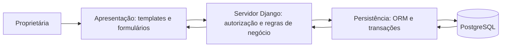

# Arquitetura, tecnologias e implantação planejadas

## Arquitetura monolítica em camadas

Uma aplicação, com módulos lógicos separados. Não serão criados microsserviços. O objetivo é facilitar compreensão, implementação individual, testes e manutenção.

| Parte | Recebe / produz | Responsabilidade e comunicação |
|---|---|---|
| Apresentação | Produto selecionado, quantidade; resumo e mensagens | Interagir com a usuária; enviar solicitações ao servidor, sem acessar o banco. |
| Negócio | Identificadores, quantidades, chave da operação; resultado | Autorizar cada operação, validar produtos e estoque, calcular total e coordenar transação. |
| Persistência | Consultas e gravações; dados e resultados | Acessar o banco por ORM; garantir relacionamentos e restrições. |

No Django, views receberão solicitações, forms validarão dados, serviços concentrarão operações de negócio e models/ORM realizarão persistência. Templates apresentarão os resultados. A separação lógica pode coexistir com a organização própria do Django; não depende de múltiplos servidores.

## Fluxo central

1. A usuária autenticada seleciona itens e confere o resumo.
2. O servidor verifica conta, autorização, CSRF, produtos ativos e quantidades positivas compatíveis com UN/KG.
3. Consulta os preços atuais e calcula valores usando decimais e regra de arredondamento a definir explicitamente.
4. Usa uma chave única para reconhecer reenvios da mesma operação.
5. Em transação, verifica disponibilidade com bloqueio/atualização condicional adequada à concorrência, grava venda e itens e reduz estoque.
6. Falha causa rollback; sucesso retorna número, total e quantidades atualizadas.
7. Falha de rede com resultado desconhecido exige consulta da operação antes de reenviar; não se presume que a venda falhou.

## Tecnologias essenciais previstas

| Recurso | Versão pretendida | Função |
|---|---|---|
| Python | 3.13.x | Runtime e regras do sistema. |
| Django | 5.2 LTS com correções atualizadas | Rotas, forms, autenticação, sessões, templates, ORM e testes. |
| HTML e templates Django | HTML5 / versão do Django | Interface renderizada no servidor, sem SPA separada. |
| Bootstrap | 5.3.x | Componentes responsivos, a adaptar e verificar quanto à acessibilidade. |
| Psycopg | 3.x compatível | Driver de integração com PostgreSQL. |
| Gunicorn | A fixar em versão compatível | Servidor WSGI Linux na implantação. |
| Limitador de tentativas | Implementação adicional a definir e testar | Django não fornece limitação de login automaticamente. |

Forms, autenticação, ORM e TestCase são recursos do mesmo Django, não pacotes independentes. Não foi gerado requirements.txt porque a aplicação e a seleção completa de versões ainda não existem.

## Banco e administração

PostgreSQL local no desenvolvimento e hospedado/gerenciado na implantação. Modela produtos, vendas e itens relacionados; suporta transações para evitar confirmação parcial. Provedor/plano, versão suportada, custos e limites precisam ser confirmados. O banco não será acessível diretamente pelo navegador.

Backups diários com retenção a definir, armazenamento protegido separado e restauração testada. Se o plano não oferecer backup, será necessário automatizar exportações com pg_dump. Serviço gerenciado não dispensa verificação de retenção, acesso e recuperação.

## RNF03: hospedagem e portabilidade

Referência de implantação: Render, Linux, PostgreSQL gerenciado e HTTPS. Hospedagem não foi contratada ou configurada. Desenvolvimento suportado em Windows e Linux; acesso previsto em Chrome/Firefox atualizados e Chrome Android.

A implantação deverá ser reproduzível com código versionado, dependências completas fixadas, migrações, coleta de estáticos, comandos de inicialização e instruções. SECRET_KEY, credenciais, endereço do banco, hosts e configuração por ambiente ficarão em variáveis de ambiente. DEBUG=False na implantação.

O plano gratuito do Render é referência somente para demonstração: web suspende após 15 minutos de inatividade e PostgreSQL gratuito expira após 30 dias, conforme a documentação consultada. Limites devem ser reconfirmados. Uso regular dependerá de orçamento e plano com continuidade e backup adequados. Não se propõe contornar limites de serviço.

## Verificação de desempenho e portabilidade

- Página: consulta de estoque, primeira página com 25 produtos.
- Limite: mediana de **até 3 segundos** até resultados visíveis e interface utilizável.
- Dispositivo: Android, 2 GB RAM, processador de quatro núcleos; modelo e versões registrados.
- Rede controlada: 1,5 Mbps download, 750 kbps upload, 150 ms latência; comparada às condições locais quando confirmadas.
- Base fictícia: 500 produtos e 5.000 vendas.
- Procedimento: uma execução de aquecimento, depois cinco medições, cache do navegador desativado, mesmo estado autenticado e servidor aquecido.
- Ferramenta: Chrome DevTools Network/Performance; timestamps que identifiquem resultados visíveis/utilizáveis. O evento load isolado não basta.
- Preservar tempos individuais, mediana, versão do código, dependências, infraestrutura, base e configuração da rede. Cold start será medido separadamente.
- Portabilidade: reproduzir instalação e fluxos em Windows/Linux local e hospedagem Linux.
- Falha de implantação: revisar runtime, dependências, variáveis, estáticos, migrações e conexão.
- Falha de meta: revisar consultas e índices, paginação, recursos, compactação, cache de estáticos e capacidade; repetir nas mesmas condições.

Nada deste procedimento foi executado até o momento. Plano, disponibilidade e custos ainda são pendências.
