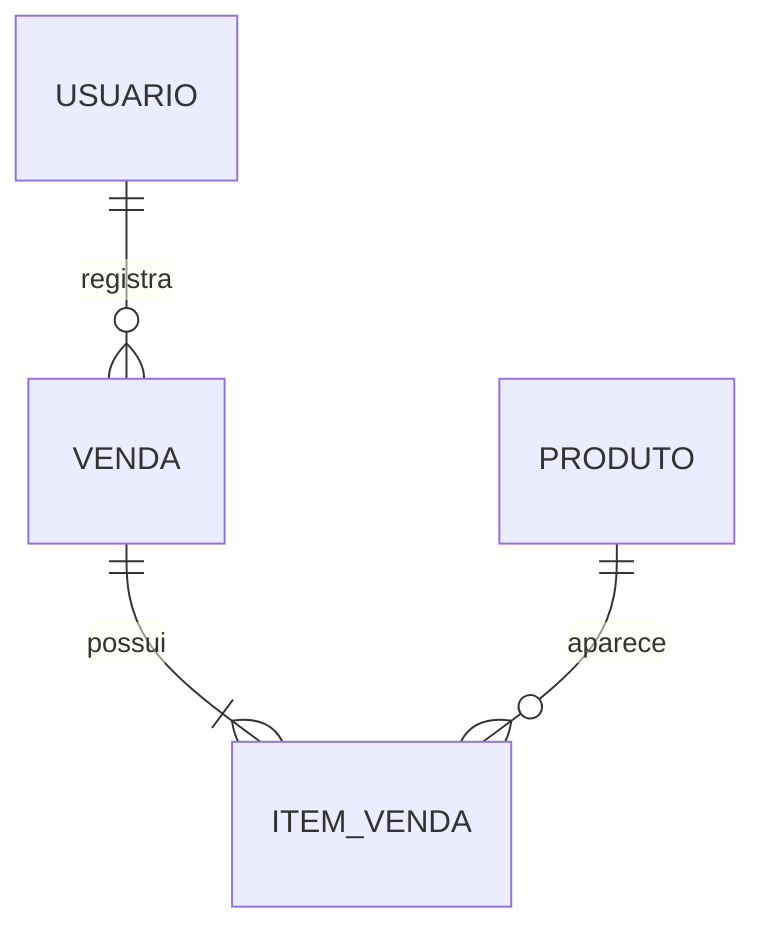

# Modelo lógico proposto

| Entidade | Identificador | Atributos principais | Regras |
|---|---|---|---|
| Usuário | id: inteiro, PK | username: texto único obrigatório; password: hash obrigatório; is_active: booleano; permissão de proprietária via permissões/grupo Django | Sem cadastro público; sem senha legível; conta ativa e autorizada. |
| Produto | id: inteiro, PK | nome: texto obrigatório; preco: decimal(12,2); quantidade_estoque: decimal(12,3); unidade: UN/KG; ativo: booleano | Preço positivo, estoque não negativo; UN exige quantidade inteira. |
| Venda | id: inteiro, PK | usuario_id: FK obrigatória; data_hora: timestamp; total: decimal(12,2); chave_operacao: UUID único obrigatório | Ao menos um item; total calculado no servidor; atomicidade e idempotência. |
| ItemVenda | id: inteiro, PK | venda_id: FK; produto_id: FK; quantidade: decimal(12,3); preco_unitario: decimal(12,2); unidade_vendida: UN/KG | Quantidade e preço positivos; preservar preço/unidade históricos; proteger referências. |

Um usuário registra muitas vendas por Venda.usuario_id. Uma venda tem muitos itens por ItemVenda.venda_id. Um produto aparece em muitos itens por ItemVenda.produto_id. Chaves estrangeiras evitam repetir cadastros completos e preservam o contexto. Não se deve interpretar o diagrama como modelo físico já implementado.

## Operações e coerência

O login consulta Usuário. Cadastro cria Produto; consulta e edição leem/atualizam seus dados. Produtos fora de comercialização serão desativados. Ao confirmar a venda, o sistema consulta produtos e preços, cria Venda/ItemVenda e atualiza estoque atomicamente. Falhas desfazem todas essas alterações. Vendas confirmadas não serão excluídas no fluxo inicial.

A chave única de operação impede duplicação por reenvio e exige tratar concorrência também no banco. Uma transação isoladamente não evita venda acima do saldo; será necessária atualização condicional ou bloqueio dos registros e teste concorrente.

Correções de quantidade são ajustes explícitos e autorizados, não substituições silenciosas durante uma edição de nome/preço. O mecanismo de reposição e a política de correção de vendas confirmadas precisam ser refinados com a parceira antes do uso real. O primeiro modelo não possui histórico completo de ajustes.

## Minimização e evolução

Armazenar identificador do responsável é necessário para rastrear operações. Nome, CPF e telefone dos clientes não serão coletados. Não haverá perfil de marketing ou dados pessoais de consumidores.

Uma futura entidade MovimentaçãoEstoque poderá detalhar entradas, perdas e ajustes com seus motivos. Esse histórico separado não integra o escopo inicial. O uso de KG no protótipo é uma hipótese a validar, não comprovação de integração com balança.
