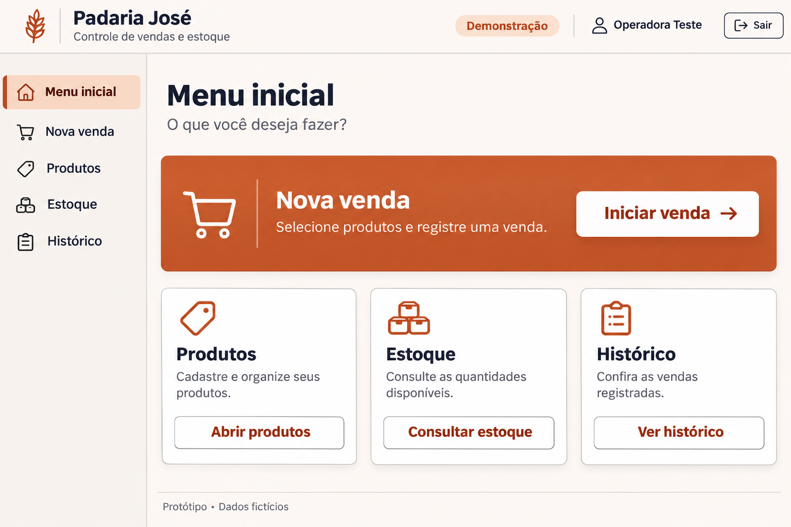
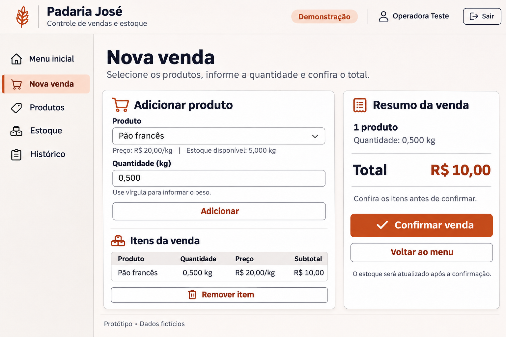
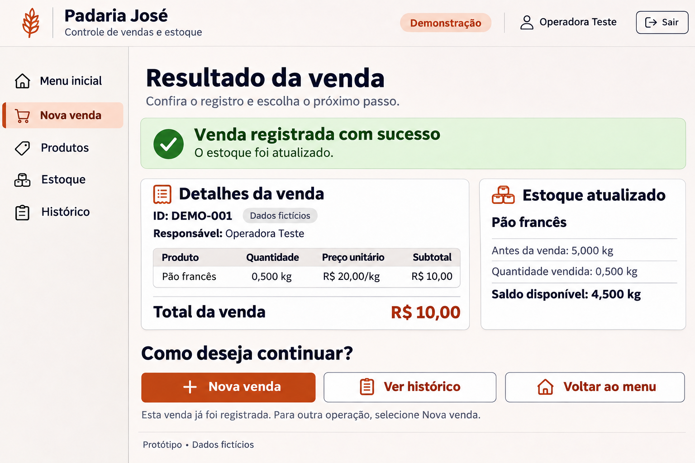

# Plano e descrição das três telas

As três imagens são protótipos estáticos produzidos com geração de imagens assistida por IA. Foram revisadas visualmente durante a criação. Não são capturas de aplicação executável, evidências de campo ou demonstração de conformidade técnica.

| Tela | Objetivo e componentes | Ação/navegação | Requisitos e acessibilidade representados |
|---|---|---|---|
| 1. Menu inicial | Orientar a usuária após login; identificação da solução, conta fictícia, demonstração, menu lateral e cartões | Iniciar venda vai à tela 2; Produtos/Estoque/Histórico são destinos planejados; Sair deverá encerrar sessão | RF01 representado como estado autenticado; acesso a RF02–RF05; RNF04: hierarquia, ícones com texto e controles amplos |
| 2. Nova venda | Produto, preço/unidade, estoque disponível, quantidade, Adicionar, itens, Remover item, resumo/total | Confirmar leva ao resultado; Voltar ao menu abandona rascunho após confirmação se necessário | RF03/RF04; RNF01/RNF02 dependem de servidor; RNF04: rótulos persistentes, instruções, ordem de leitura |
| 3. Resultado | Estado de sucesso, ID, responsável fictício, itens, total e saldo anterior/saída/atual | Nova venda inicia outra; Ver histórico abre consulta; Voltar ao menu retorna | RF04 e conferência de RF05; RNF04: texto + símbolo + cor de sucesso |

## Dados fictícios consistentes

- Operadora Teste; ambiente Demonstração.
- Pão francês: R$ 20,00/kg.
- Saldo anterior: 5,000 kg; venda: 0,500 kg; subtotal/total: R$ 10,00.
- Venda: DEMO-001; saldo posterior: 4,500 kg.
- Cenário de erro a representar futuramente: tentativa de 6,000 kg quando existem 5,000 kg; recusar sem confirmar.

## Tela 1

O cabeçalho identifica o controle de vendas/estoque e o ambiente demonstrativo. A ação Nova venda é prioritária. Produtos, Estoque e Histórico aparecem com ícones e rótulos no menu e cartões. O destaque do menu inicial orienta a localização. Sair é um controle planejado, sem sessão real na imagem.

## Tela 2

Produto e quantidade serão obrigatórios. A imagem já mostra um item selecionado e adicionado, não a sequência interativa. A instrução sobre vírgula, preço e unidade reduz ambiguidade. Remover item corrige antes de confirmar. Voltar não deverá registrar venda. Confirmação real exige servidor, autorização, CSRF, cálculo decimal, disponibilidade, idempotência e transação. O estado Processando é previsto na especificação, mas não está representado nesta captura de estado pronto para confirmar.

## Tela 3

O sucesso é comunicado por texto, símbolo de confirmação e cor verde. Detalhes e saldo permitem conferir o efeito da venda; não há filtro. O aviso de que a venda já foi registrada orienta a não confirmar de novo. Os botões deixam explícitos os próximos passos. A captura representa somente sucesso, não telas adicionais de erro.

## Consistência e limites

Manter rótulos Produto, Quantidade, Unidade, Estoque disponível e Total. Falha de conexão não deverá ser sucesso; resultado desconhecido exige verificação antes de reenvio. Sessão expirada exige autenticação e preservação segura do rascunho, sem executar a venda automaticamente.

Imagens sugerem contraste e controles amplos, mas medidas de 44 px CSS, contraste 4,5:1, zoom a 200%, foco, teclado, rótulos programáticos e anúncios por leitor de tela precisam ser implementados e medidos. A captura desktop não confirma comportamento responsivo no aparelho real. A hipótese a validar é a compreensão da seleção de produto e da diferença entre UN e KG.

Filtros por período, telas completas de cadastro/histórico e fluxos de erro não foram desenhados nesta série de três capturas. Isso limita o que a validação pode comprovar, sem retirar os requisitos obrigatórios da futura implementação.

Os prompts utilizados estão em [prototipos/prompts](../prototipos/prompts/). O primeiro é um registro resumido; os demais preservam as instruções de geração.
